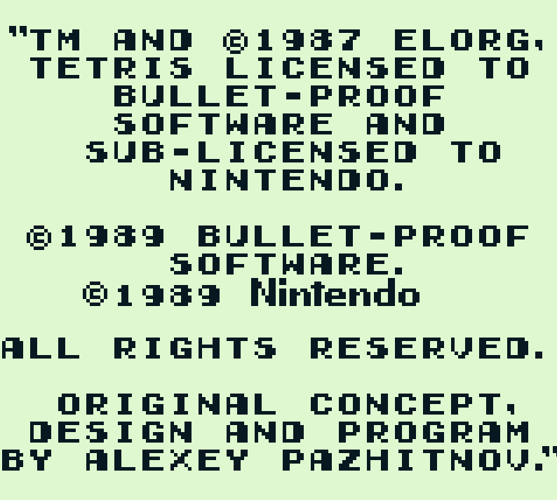

# qgb

A DMG Game Boy emulator written in C++.  
Currently, we can play Tetris on it.  



## Features & Accuracy

- Implement all basic opcodes, pass Blargg's CPU tests
- PPU (background, window, sprites/OAM, palettes), timing is not accurate yet (render whole scanline)
- Input joypad

## Build

### Dependencies

* SDL3

### How to build

Run: 

```
git clone --recurse-submodules https://github.com/nmq443/qgb.git
cd qgb
cmake -S . -B build
cmake --build build
```

If you are on linux, cmake will prompt that configuration step is failed because we did not install sdl's dependencies, so please install those dependencies.

##